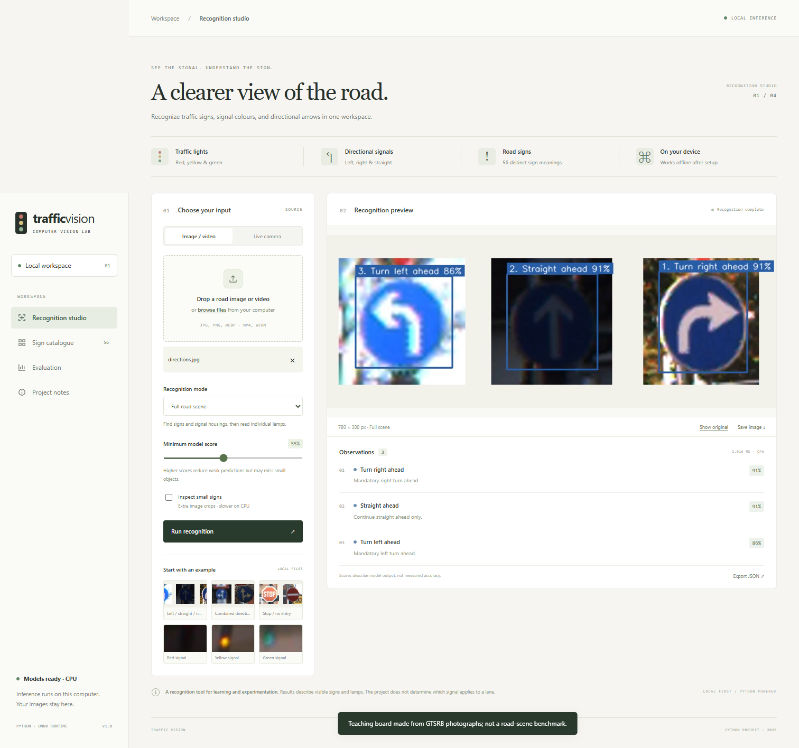
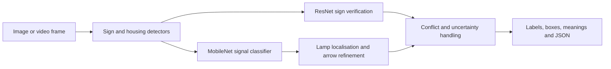

# Traffic Vision

A Python college project for **traffic signs, traffic lights and directional signal
recognition**, running locally in your browser. No inference API, API key or cloud
upload is used. After setup, inference works offline.



## Start on Windows

Python 3.12 is recommended. Open PowerShell in the project folder:

```powershell
powershell -ExecutionPolicy Bypass -File setup.ps1
.\start.bat
```

Open **http://127.0.0.1:8765**. Keep the server terminal running. Stop with Ctrl+C.
`setup.ps1` installs locked dependencies with uv when available, otherwise uses pip.
It downloads approximately 255 MB of checksummed models; the first inference verifies
their hashes and loads them. If the GitHub repository is private, sign in with
`gh auth login` so the downloader can retrieve its converted model release assets.

Without the Windows launcher:

```bash
uv sync --locked
uv run python scripts/download_models.py
uv run python -m traffic_vision
```

With Python/pip (macOS/Linux):

```bash
python3 -m venv .venv
source .venv/bin/activate
python -m pip install -r requirements.txt
python scripts/download_models.py
python -m traffic_vision
```

Change the port with `python -m traffic_vision --port 8766`. A CPU is sufficient;
an NVIDIA GPU is not required. Use Chrome or Edge for camera/video features.

## What works

- **Full scene:** bounding boxes, explicit sign meanings, model scores and uncertain states.
- **Directions:** left, right, straight, keep-left/right, combined directions, and roundabouts.
- **Prohibitions:** no left/right/U-turn, no entry, no parking/stopping and overtaking restrictions.
- **Other signs:** STOP, give way, posted speed values, hazards, crossings and information signs.
- **Close-up signal:** colour and supported arrow combinations. A red circle and a green
  left arrow stay separate observations, rather than becoming a “red left arrow.”
- **Live webcam:** browser permission required; frames processed locally one at a time.
- **Video:** MP4/WebM decoded in the browser and scanned at one-second intervals,
  up to 1,000 frames per scan. This is sampled video recognition, not guaranteed real-time FPS.
- **Export:** the current annotated image and JSON observations, including sampled video timestamps.
- **Catalogue:** searchable list of the exact supported sign classes.
- **Evaluation:** reproducible dataset evaluator and a local results page.

Use **Full road scene** for signs and road photographs. Use **Close-up traffic signal**
for a tightly cropped signal housing. “Inspect small signs” adds overlapping image
crops and takes longer. The six included samples are selected teaching examples.

For manual validation, open the [104-image gallery](http://127.0.0.1:8765/samples/validation/index.html)
or download [the sample ZIP](samples/traffic-vision-validation-pack.zip). It contains
86 sign crops across all 43 GTSRB classes and 18 signal colour crops, with an
[answer key](samples/validation/expected-results.csv). Use the mode listed for each
image. This selection was not run through recognition or selected for success;
upstream training overlap is unknown. It has no verified arrow-lamp direction labels.

## How recognition works



The backend uses FastAPI, OpenCV, NumPy and ONNX Runtime. The interface is plain
HTML/CSS/JavaScript with local fonts and assets. PyTorch is unnecessary for inference.
See [model provenance](THIRD_PARTY_NOTICES.md) and [model-manifest.json](model-manifest.json).

## Accuracy and scope

This release uses pretrained models, **not newly trained custom weights**. In a small
public-sample check, 36/36 selected sign crops were correctly accepted;
15/18 signal crops were correctly accepted and three were uncertain.
There were no incorrect accepted labels in that check. **This is not an independent
road-scene accuracy result**: training overlap is unknown, and the check was used
during development. See [the full validation record](docs/VALIDATION.md).

95% precision and 90% recall are development targets. Accuracy on Indian roads,
arrow lamps, all prohibition classes, night scenes, and unfamiliar sign designs has
not been established. High model scores do not guarantee correctness. The app cannot
reliably reject every unknown sign, determine lane relevance, read painted road arrows
or arbitrary text boards, or combine observations into driving decisions.

## Evaluation and training

Copy and populate [the dataset example](docs/evaluation.example.json), then run:

```bash
python scripts/evaluate.py --dataset data/evaluation.json --split test
```

The Evaluation page reads `outputs/evaluation.json`. The evaluator checks recording
groups and duplicate content, matches exact classes at IoU >= 0.5, counts misses,
and records precision/recall, abstentions, confusion pairs and model/dataset hashes.

To fine-tune with your own YOLO-labelled dataset:

```bash
uv sync --extra training --extra dev
uv run python scripts/train.py --data data/traffic.yaml --device cpu
```

Use a GPU for larger training runs. Direction-changing flips are disabled. Custom
weights need a matching manifest, labels and catalogue mappings before installation;
they do not automatically replace the bundled models. Freeze validation thresholds
before evaluating the final test recording.

## Development

```bash
uv sync --locked --extra dev
uv run pytest -q
uv run ruff check .
uv run python scripts/check_browser.py
```

The browser check uses installed Edge/Chrome, or a Playwright Chromium installation.
The API is documented at http://127.0.0.1:8765/docs. Frames stay in memory; results
are saved only when you export them. Evaluation scripts explicitly write reports.

## Submission material

- [Implementation plan](docs/PLAN.md)
- [Project report](docs/REPORT.md)
- [Presentation outline](docs/PRESENTATION.md)
- [Viva questions](docs/VIVA.md)
- [Validation and reproducibility](docs/VALIDATION.md)

## License

AGPL-3.0 for the project source; model and image terms remain with their authors.
See [THIRD_PARTY_NOTICES.md](THIRD_PARTY_NOTICES.md).
